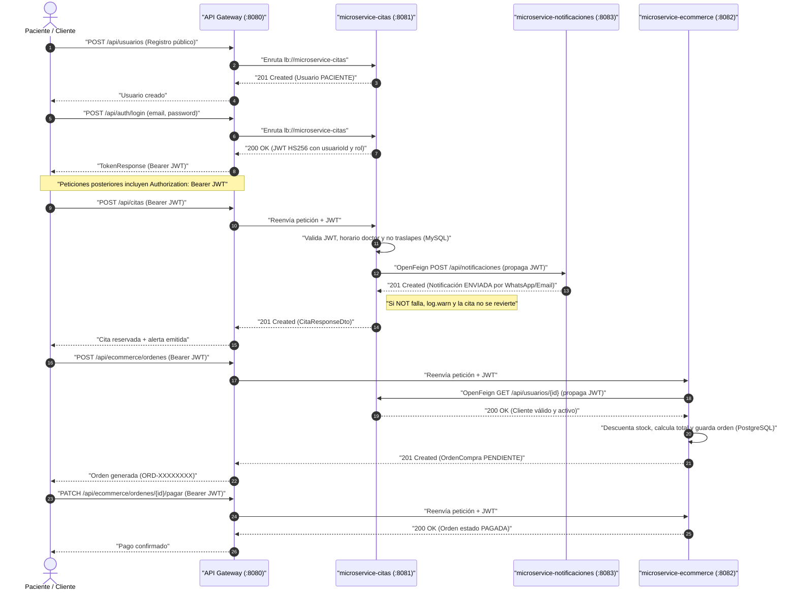
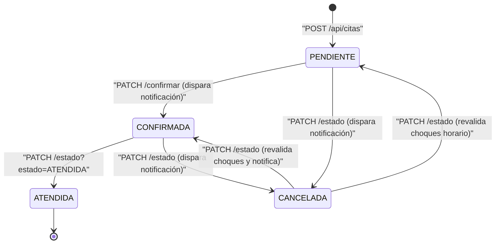
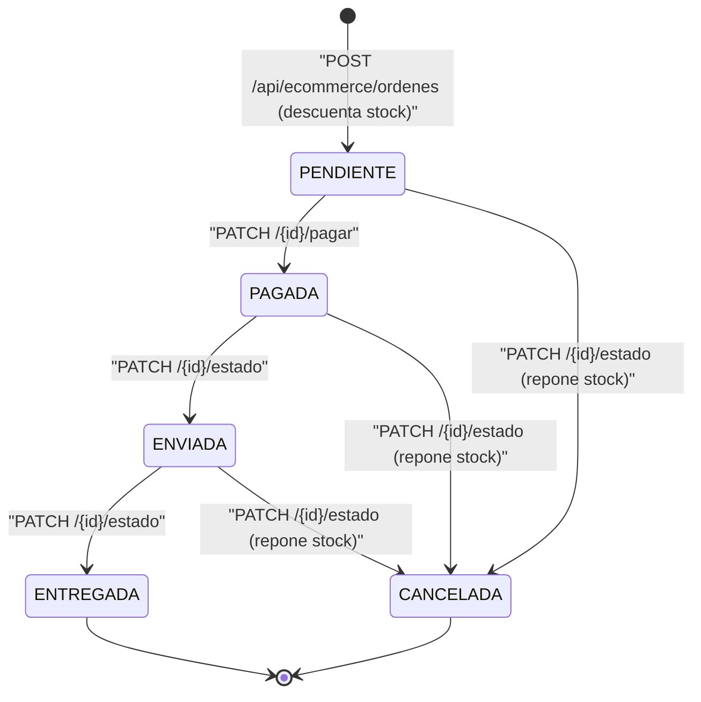
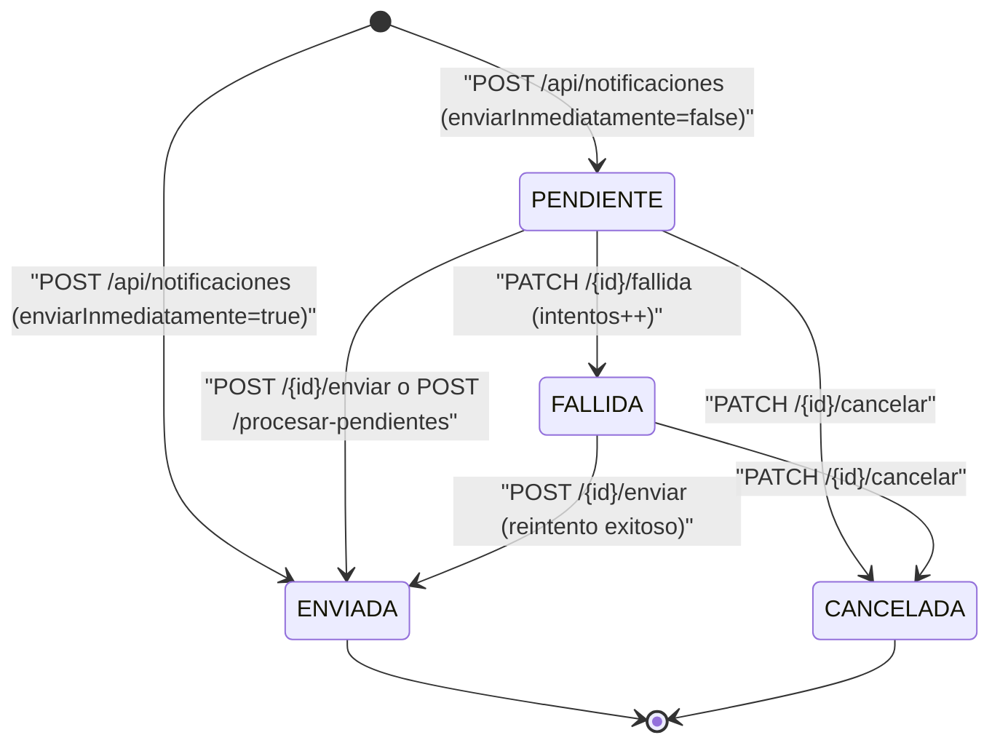
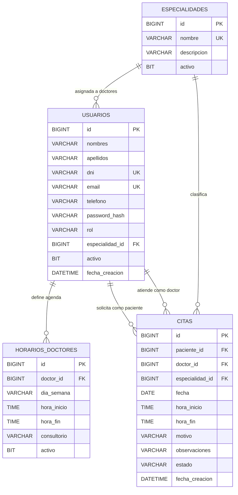
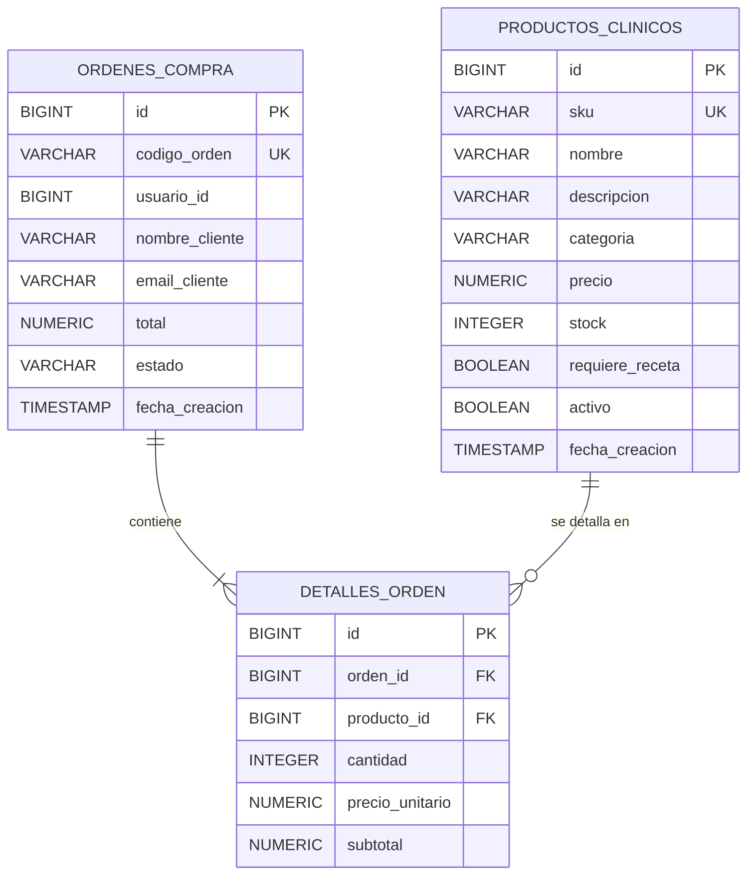
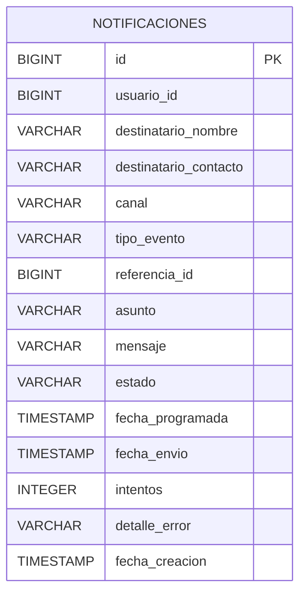
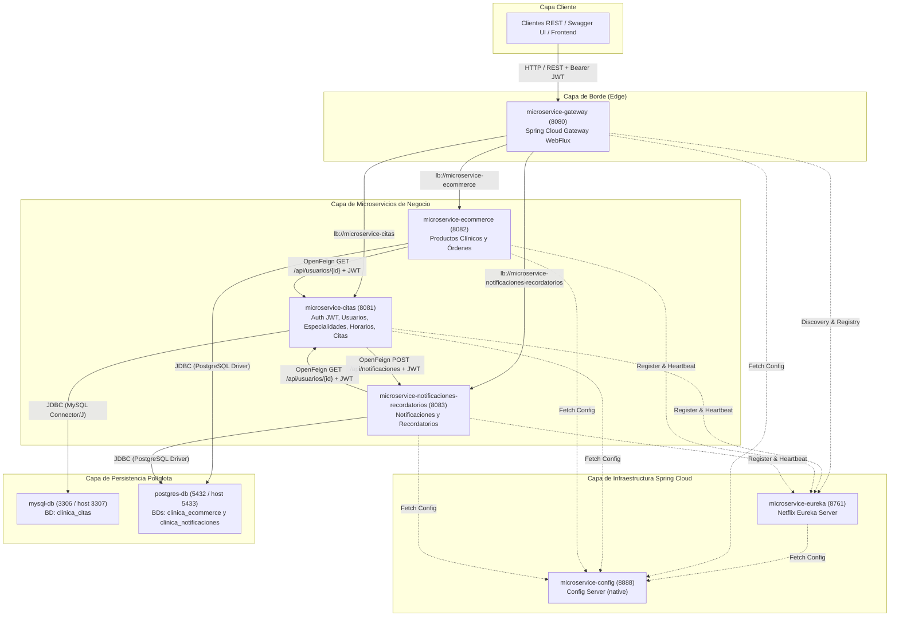
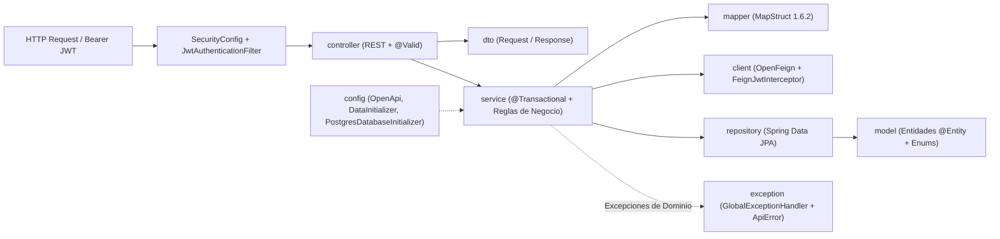
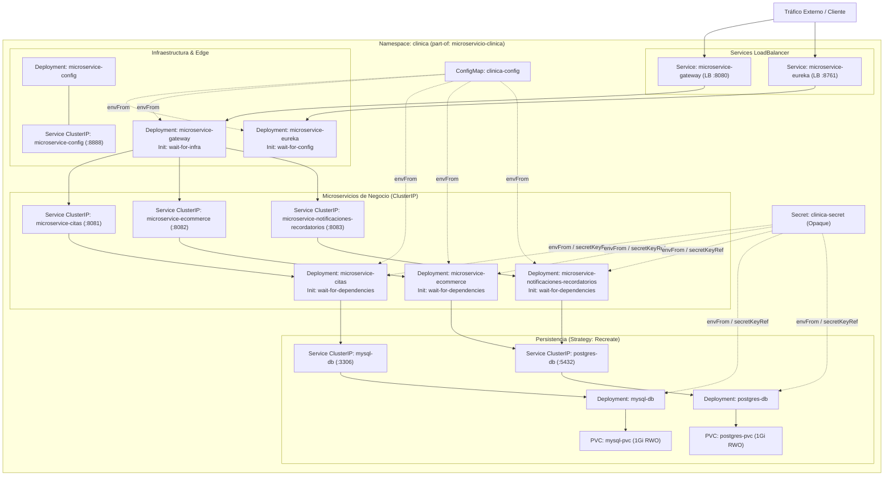

# Documentación Técnica — Ecosistema de Microservicios Clínica

**Proyecto:** `com.clinica:microservicio-clinica:0.0.1-SNAPSHOT`  
**Stack Base:** Java 21 · Spring Boot 3.3.5 · Spring Cloud 2023.0.3 · Spring Security + JWT (HS256) · MapStruct 1.6.2 · OpenAPI 3 · MySQL 8.0 · PostgreSQL 17 · Docker · Kubernetes  
**Alcance:** 6 módulos Maven (3 de infraestructura + 3 de dominio clínico), 53 endpoints REST, persistencia políglota desacoplada (*Database per Service*), enrutamiento centralizado vía API Gateway, contenerización multi-etapa y orquestación declarativa en Kubernetes.

---

## Índice General

- [1. Características del Ecosistema de Microservicios](#1-características-del-ecosistema-de-microservicios)
  - [1.1 Visión General y Catálogo de Módulos](#11-visión-general-y-catálogo-de-módulos)
  - [1.2 Características Transversales Clave](#12-características-transversales-clave)
  - [1.3 Detalle Funcional, Reglas de Negocio y Catálogo de Endpoints (53 Endpoints)](#13-detalle-funcional-reglas-de-negocio-y-catálogo-de-endpoints-53-endpoints)
  - [1.4 Matriz de Control de Acceso por Roles (RBAC)](#14-matriz-de-control-de-acceso-por-roles-rbac)
- [2. Flujo de Usuario (End-to-End)](#2-flujo-de-usuario-end-to-end)
  - [2.1 Actores del Sistema y Credenciales Precargadas](#21-actores-del-sistema-y-credenciales-precargadas)
  - [2.2 Jornadas por Perfil de Usuario](#22-jornadas-por-perfil-de-usuario)
  - [2.3 Diagrama de Secuencia End-to-End](#23-diagrama-de-secuencia-end-to-end)
  - [2.4 Diagramas de Ciclos de Vida (Máquinas de Estado)](#24-diagramas-de-ciclos-de-vida-máquinas-de-estado)
- [3. Modelo Entidad-Relación (ER) y Diseño de Persistencia](#3-modelo-entidad-relación-er-y-diseño-de-persistencia)
  - [3.1 Estrategia de Datos Distribuidos](#31-estrategia-de-datos-distribuidos)
  - [3.2 Diagramas ER por Base de Datos](#32-diagramas-er-por-base-de-datos)
  - [3.3 Diccionario de Datos, Enumeraciones y Datos Iniciales](#33-diccionario-de-datos-enumeraciones-y-datos-iniciales)
- [4. Arquitectura del Sistema](#4-arquitectura-del-sistema)
  - [4.1 Diagrama de Arquitectura General](#41-diagrama-de-arquitectura-general)
  - [4.2 Arquitectura Interna por Capas](#42-arquitectura-interna-por-capas)
  - [4.3 Patrones Arquitectónicos y Decisiones de Diseño](#43-patrones-arquitectónicos-y-decisiones-de-diseño)
- [5. Configuración del API Gateway (`microservice-gateway`)](#5-configuración-del-api-gateway-microservice-gateway)
  - [5.1 Arquitectura y Propósito](#51-arquitectura-y-propósito)
  - [5.2 Descubrimiento Dinámico y Tabla de Rutas](#52-descubrimiento-dinámico-y-tabla-de-rutas)
  - [5.3 Configuración YAML de Referencia](#53-configuración-yaml-de-referencia)
  - [5.4 Actuator y Estrategia de Seguridad en el Borde](#54-actuator-y-estrategia-de-seguridad-en-el-borde)
- [6. Dependencias y Herramientas Utilizadas](#6-dependencias-y-herramientas-utilizadas)
  - [6.1 Stack Principal y Versiones](#61-stack-principal-y-versiones)
  - [6.2 Matriz de Dependencias por Módulo Maven](#62-matriz-de-dependencias-por-módulo-maven)
  - [6.3 Configuración de Compilación y Procesadores de Anotaciones](#63-configuración-de-compilación-y-procesadores-de-anotaciones)
  - [6.4 Herramientas de Desarrollo, Operación y Verificación](#64-herramientas-de-desarrollo-operación-y-verificación)
- [7. Docker y Configuración de Contenedores](#7-docker-y-configuración-de-contenedores)
  - [7.1 Análisis del `Dockerfile` Multi-Etapa Parametrizado y `.dockerignore`](#71-análisis-del-dockerfile-multi-etapa-parametrizado-y-dockerignore)
  - [7.2 Análisis de `docker-compose.yml`](#72-análisis-de-docker-composeyml)
  - [7.3 Variables de Entorno y Comandos Operativos Docker](#73-variables-de-entorno-y-comandos-operativos-docker)
- [8. Orquestación con Kubernetes (`k8s/`)](#8-orquestación-con-kubernetes-k8s)
  - [8.1 Diagrama de Topología en Kubernetes](#81-diagrama-de-topología-en-kubernetes)
  - [8.2 Desglose de Manifiestos (`00` a `05`)](#82-desglose-de-manifiestos-00-a-05)
  - [8.3 Decisiones Clave de Ingeniería y Matriz de Recursos](#83-decisiones-clave-de-ingeniería-y-matriz-de-recursos)
  - [8.4 Guía de Despliegue, Verificación y Evolución a Producción](#84-guía-de-despliegue-verificación-y-evolución-a-producción)

---

## 1. Características del Ecosistema de Microservicios

### 1.1 Visión General y Catálogo de Módulos

El sistema implementa una plataforma clínica integral organizada bajo un proyecto Maven multi-módulo (`microservicio-clinica`), dividida en **3 servicios de infraestructura** (configuración centralizada, registro/descubrimiento y puerta de enlace) y **3 microservicios de negocio** (gestión médica/citas, e-commerce clínico y notificaciones/recordatorios).

| Orden de Arranque | Módulo Maven | Rol Arquitectónico | Puerto | Base de Datos | Imagen Docker |
| :---: | :--- | :--- | :---: | :--- | :--- |
| `1` | `microservice-config` | Spring Cloud Config Server (`native`) | `8888` | N/A | `polox2x2/microservice-config:1.0` |
| `2` | `microservice-eureka` | Netflix Eureka Discovery Server | `8761` | N/A | `polox2x2/microservice-eureka:1.0` |
| `3` | `microservice-citas` | Autenticación JWT, Usuarios, Especialidades, Horarios y Citas | `8081` | MySQL 8.0 (`clinica_citas`) | `polox2x2/microservice-citas:1.0` |
| `4` | `microservice-ecommerce` | Catálogo de Productos Clínicos y Órdenes de Compra | `8082` | PostgreSQL 17 (`clinica_ecommerce`) | `polox2x2/microservice-ecommerce:1.0` |
| `5` | `microservice-notificaciones-recordatorios` | Programación, Envío y Seguimiento de Alertas (WhatsApp/Email/SMS) | `8083` | PostgreSQL 17 (`clinica_notificaciones`) | `polox2x2/microservice-notificaciones:1.0` |
| `6` | `microservice-gateway` | Spring Cloud API Gateway reactivo (punto de entrada único) | `8080` | N/A | `polox2x2/microservice-gateway:1.0` |

> **Nota de nomenclatura:** En `microservice-notificaciones-recordatorios`, el módulo Maven, el `spring.application.name` y el Service/Deployment de Kubernetes utilizan `microservice-notificaciones-recordatorios`, mientras que su imagen Docker se publica como `polox2x2/microservice-notificaciones:1.0` y su contenedor en Docker Compose lleva `container_name: clinica-notificaciones`.

---

### 1.2 Características Transversales Clave

1. **Persistencia Políglota (*Database per Service*) y Autoprovisión de Bases de Datos:**
   - **`microservice-citas` (MySQL 8.0):** Utiliza el parámetro JDBC `createDatabaseIfNotExist=true` sobre `clinica_citas` junto con `hibernate.ddl-auto: update` y `serverTimezone=America/Lima`.
   - **`microservice-ecommerce` y `microservice-notificaciones-recordatorios` (PostgreSQL 17):** Incorporan la clase `PostgresDatabaseInitializer`, que implementa `BeanFactoryPostProcessor`, `EnvironmentAware` y `Ordered` (`Ordered.HIGHEST_PRECEDENCE`). Antes de que Spring inicialice `DataSource` y JPA/Hibernate, valida el nombre de la base de datos destino con la expresión regular `^[a-zA-Z_][a-zA-Z0-9_]*$`, se conecta a la base administrativa `/postgres` y consulta `pg_database`; si `clinica_ecommerce` o `clinica_notificaciones` no existen, ejecuta `CREATE DATABASE` automáticamente.
2. **Precarga Idempotente de Datos (`DataInitializer` + Scripts SQL):**
   - Cada microservicio de negocio define un componente `DataInitializer` (`CommandLineRunner`) ejecutado dentro de `@Transactional` que verifica si las tablas principales están vacías (`count() == 0`) antes de insertar datos de prueba.
   - Adicionalmente, el directorio `sql/` proporciona tres scripts SQL standalone (`01_mysql_clinica_citas.sql`, `02_postgres_clinica_ecommerce.sql`, `03_postgres_clinica_notificaciones.sql`) idempotentes (`INSERT IGNORE` en MySQL y `ON CONFLICT (id) DO NOTHING` + `setval(...)` en PostgreSQL).
3. **Seguridad *Stateless* con JWT (HS256) y Control Basado en Roles (RBAC):**
   - Las contraseñas se cifran con `BCryptPasswordEncoder`.
   - `microservice-citas` autentica credenciales en `POST /api/auth/login` y emite un token JWT firmado con HMAC-SHA256 (`JJWT 0.12.6`) utilizando la clave compartida `JWT_SECRET` (por defecto `ClinicaMicroserviciosSecretKey2026SuperSeguraParaJwtHS256!`) y TTL `JWT_EXPIRATION_MS` (`86400000` ms = 24 horas).
   - El token incluye `sub` (email del usuario), `usuarioId`, `rol`, `iat` y `exp`.
   - Los 3 microservicios de negocio configuran `SessionCreationPolicy.STATELESS`, CSRF deshabilitado, CORS habilitado, `@EnableMethodSecurity` y el filtro `JwtAuthenticationFilter` (`OncePerRequestFilter`), el cual extrae el rol del token y construye la autoridad `ROLE_<ROL>`. Ante ausencia o invalidez del token, el `AuthenticationEntryPoint` responde `401 Unauthorized` con el mensaje `"Token JWT ausente o inválido"`.
4. **Propagación de Identidad y Comunicación Inter-Servicio con OpenFeign:**
   - Todos los microservicios de negocio habilitan `@EnableFeignClients` y registran `FeignJwtInterceptor` (`RequestInterceptor`).
   - Cuando existe un contexto HTTP activo (`RequestContextHolder.getRequestAttributes()`) con cabecera `Authorization`, el interceptor la propaga íntegramente a la petición saliente. Si no existe cabecera entrante (por ejemplo, ejecución interna/asíncrona), `JwtService.generateInternalServiceToken()` firma un token técnico temporal con sujeto `"internal-service"`, `usuarioId = 0L`, rol `"ADMIN"` y vigencia de `300_000` ms (5 minutos).
   - **Integraciones activas:**
     - `microservice-citas` → `microservice-notificaciones-recordatorios` (`NotificacionClient` → `POST /api/notificaciones`): envía alertas de reserva, confirmación o cancelación de citas. Implementa **degradación controlada** mediante bloque `try/catch` en `CitaService.notificarEventoCita`; si el servicio de notificaciones falla o no responde, registra una advertencia en log (`log.warn`) sin abortar la transacción de la cita.
     - `microservice-ecommerce` → `microservice-citas` (`UsuarioClient` → `GET /api/usuarios/{id}`): valida que el comprador exista y tenga `activo = true` antes de crear una orden. Si el cliente no existe (`404`) o está inactivo, rechaza la orden; si falla Feign, lanza `BusinessRuleException` con el código HTTP recibido.
     - `microservice-notificaciones-recordatorios` → `microservice-citas` (`UsuarioClient` → `GET /api/usuarios/{id}`): autocompleta `destinatarioNombre` y `destinatarioContacto` (email para canal `EMAIL`, teléfono para `WHATSAPP`/`SMS`) cuando la petición incluye `usuarioId` y omite datos de contacto.
5. **Manejo Global y Uniforme de Excepciones:**
   - Cada microservicio de negocio define `@RestControllerAdvice` (`GlobalExceptionHandler`) que retorna el record `ApiError(timestamp, status, error, message, path, validationErrors)` para:
     - `ResourceNotFoundException` → `404 Not Found`
     - `BusinessRuleException` → `400 Bad Request`
     - `MethodArgumentNotValidException` → `400 Bad Request` (con mapa campo-error en `validationErrors`)
     - `BadCredentialsException` → `401 Unauthorized`
     - `AccessDeniedException` → `403 Forbidden`
     - `Exception` no controlada → `500 Internal Server Error`
6. **Documentación OpenAPI 3 / Swagger UI (`springdoc-openapi` 2.6.0):**
   - Cada microservicio de negocio configura `OpenApiConfig` con esquema de seguridad `bearerAuth` (`HTTP` / `bearer` / `JWT`) y dos servidores declarados: el API Gateway (`http://localhost:8080`) y el acceso directo al puerto del servicio (`8081`, `8082`, `8083`).
7. **Observabilidad y Buenas Prácticas JPA:**
   - Todos los módulos exponen endpoints de `Spring Boot Actuator` (`/actuator/health`, `/actuator/info`, más `/actuator/gateway` en el Gateway).
   - Se configura explícitamente `spring.jpa.open-in-view: false` en los 3 servicios de negocio para evitar retención de conexiones de base de datos durante la serialización HTTP.
   - La conversión entre entidades JPA y DTOs se realiza en tiempo de compilación mediante **MapStruct 1.6.2**.

---

### 1.3 Detalle Funcional, Reglas de Negocio y Catálogo de Endpoints (53 Endpoints)

#### A. `microservice-citas` — Puerto `8081` (29 Endpoints)

Gestiona la identidad clínica, catálogo de especialidades, agenda semanal de doctores y ciclo completo de citas médicas sobre **MySQL (`clinica_citas`)**.

| Controlador | Ruta Base | Método y Subruta | Descripción Funcional |
| :--- | :--- | :--- | :--- |
| `AuthController` | `/api/auth` | `POST /login` | Autentica por `email` (case-insensitive) y `password`, valida `activo = true` y emite `TokenResponse` con JWT. |
| `UsuarioController` | `/api/usuarios` | `GET /` | Lista todos los usuarios registrados. |
| `UsuarioController` | `/api/usuarios` | `GET /{id}` | Obtiene el detalle de un usuario por su ID. |
| `UsuarioController` | `/api/usuarios` | `GET /rol/{rol}` | Filtra usuarios por `RolUsuario` (`PACIENTE`, `DOCTOR`, `ADMIN`). |
| `UsuarioController` | `/api/usuarios` | `GET /doctores/especialidad/{especialidadId}` | Lista doctores activos pertenecientes a una especialidad médica. |
| `UsuarioController` | `/api/usuarios` | `POST /` | Registra un usuario nuevo (ruta pública; si se omite `password`, asigna `"123456"` codificado en BCrypt). |
| `UsuarioController` | `/api/usuarios` | `PUT /{id}` | Actualiza datos de usuario, rol, especialidad y opcionalmente contraseña. |
| `UsuarioController` | `/api/usuarios` | `PATCH /{id}/estado?activo=` | Activa o inactiva lógicamente a un usuario. |
| `EspecialidadController` | `/api/especialidades` | `GET /` | Lista todas las especialidades médicas. |
| `EspecialidadController` | `/api/especialidades` | `GET /activas` | Lista únicamente las especialidades con `activo = true`. |
| `EspecialidadController` | `/api/especialidades` | `GET /{id}` | Obtiene una especialidad por ID. |
| `EspecialidadController` | `/api/especialidades` | `POST /` | Crea una nueva especialidad médica. |
| `EspecialidadController` | `/api/especialidades` | `PUT /{id}` | Actualiza nombre, descripción y estado de una especialidad. |
| `EspecialidadController` | `/api/especialidades` | `DELETE /{id}` | Elimina una especialidad si no tiene doctores asociados. |
| `HorarioDoctorController` | `/api/horarios` | `GET /` | Lista todos los bloques horarios registrados. |
| `HorarioDoctorController` | `/api/horarios` | `GET /{id}` | Obtiene un bloque horario por ID. |
| `HorarioDoctorController` | `/api/horarios` | `GET /doctor/{doctorId}?soloActivos=false` | Lista la disponibilidad de un doctor (todos o solo activos). |
| `HorarioDoctorController` | `/api/horarios` | `POST /` | Registra un bloque horario semanal (`DayOfWeek`, rango y consultorio). |
| `HorarioDoctorController` | `/api/horarios` | `PUT /{id}` | Actualiza un bloque horario validando solapamientos. |
| `HorarioDoctorController` | `/api/horarios` | `DELETE /{id}` | Elimina un bloque horario médico. |
| `CitaController` | `/api/citas` | `GET /` | Lista todas las citas médicas. |
| `CitaController` | `/api/citas` | `GET /{id}` | Obtiene una cita por ID. |
| `CitaController` | `/api/citas` | `GET /paciente/{pacienteId}` | Lista el historial de citas de un paciente. |
| `CitaController` | `/api/citas` | `GET /doctor/{doctorId}` | Lista la agenda de citas de un doctor. |
| `CitaController` | `/api/citas` | `GET /fecha/{fecha}` | Lista citas para una fecha ISO (`YYYY-MM-DD`). |
| `CitaController` | `/api/citas` | `POST /` | Reserva una nueva cita médica y dispara notificación vía OpenFeign. |
| `CitaController` | `/api/citas` | `PUT /{id}` | Reprograma o actualiza datos y estado de una cita. |
| `CitaController` | `/api/citas` | `PATCH /{id}/confirmar` | Cambia el estado de la cita a `CONFIRMADA` y notifica al paciente. |
| `CitaController` | `/api/citas` | `PATCH /{id}/estado?estado=` | Transiciona el estado (`PENDIENTE`, `CONFIRMADA`, `ATENDIDA`, `CANCELADA`). |

**Reglas de negocio clave en `microservice-citas`:**
- **Usuarios (`UsuarioService`):** Unicidad estricta de `dni` y `email` (normalizado en minúsculas). Un usuario con rol `DOCTOR` **debe** tener una `especialidadId` existente y activa; los roles `PACIENTE` y `ADMIN` **no** pueden tener especialidad asignada.
- **Especialidades (`EspecialidadService`):** Unicidad de nombre (case-insensitive). Se bloquea `DELETE /{id}` si `usuarioRepository.existsByEspecialidadId(id)` es verdadero.
- **Horarios (`HorarioDoctorService`):** `horaFin` debe ser estrictamente posterior a `horaInicio`; el `doctorId` debe corresponder a un usuario con rol `DOCTOR` y `activo = true`; se impide el solapamiento (`h.horaInicio < :horaFin AND h.horaFin > :horaInicio`) entre bloques activos del mismo doctor en el mismo `DayOfWeek`.
- **Citas (`CitaService`):**
  1. Valida `horaFin > horaInicio`, paciente activo (`RolUsuario.PACIENTE`), doctor activo (`RolUsuario.DOCTOR`) y especialidad activa coincidente con la especialidad del doctor.
  2. Para citas no canceladas, verifica mediante `HorarioDoctorRepository.existeHorarioDisponible` que exista un horario activo del doctor en ese `DayOfWeek` que contenga completamente el rango `[horaInicio, horaFin]`.
  3. Verifica ausencia de traslapes tanto en la agenda del doctor (`existeChoqueDoctor`) como en la del paciente (`existeChoquePaciente`), ignorando citas en estado `CANCELADA`.
  4. Al reactivar una cita previamente `CANCELADA` mediante `cambiarEstado`, re-ejecuta la validación de choques de horario.
  5. En `reservar` y en transiciones a `CONFIRMADA` o `CANCELADA`, invoca a `NotificacionClient`: selecciona `WHATSAPP` si el paciente tiene teléfono registrado o `EMAIL` en caso contrario, con `enviarInmediatamente = true`.

---

#### B. `microservice-ecommerce` — Puerto `8082` (13 Endpoints)

Administra el catálogo de equipos, insumos y fármacos clínicos junto con la generación y ciclo de vida de órdenes de compra sobre **PostgreSQL (`clinica_ecommerce`)**.

| Controlador | Ruta Base | Método y Subruta | Descripción Funcional |
| :--- | :--- | :--- | :--- |
| `ProductoClinicoController` | `/api/ecommerce/productos` | `GET /` | Lista todos los productos clínicos (activos e inactivos). |
| `ProductoClinicoController` | `/api/ecommerce/productos` | `GET /activos` | Lista únicamente productos disponibles (`activo = true`). |
| `ProductoClinicoController` | `/api/ecommerce/productos` | `GET /categoria/{categoria}` | Filtra productos activos por categoría (case-insensitive). |
| `ProductoClinicoController` | `/api/ecommerce/productos` | `GET /{id}` | Obtiene el detalle de un producto clínico. |
| `ProductoClinicoController` | `/api/ecommerce/productos` | `POST /` | Crea un nuevo producto clínico con SKU único en mayúsculas. |
| `ProductoClinicoController` | `/api/ecommerce/productos` | `PUT /{id}` | Actualiza atributos de un producto clínico existente. |
| `ProductoClinicoController` | `/api/ecommerce/productos` | `PATCH /{id}/stock?delta=` | Ajusta el inventario sumando o restando `delta`. |
| `OrdenCompraController` | `/api/ecommerce/ordenes` | `GET /` | Lista todas las órdenes de compra con sus detalles. |
| `OrdenCompraController` | `/api/ecommerce/ordenes` | `GET /{id}` | Obtiene una orden de compra por ID. |
| `OrdenCompraController` | `/api/ecommerce/ordenes` | `GET /usuario/{usuarioId}` | Lista el historial de órdenes de un usuario ordenadas por `fechaCreacion DESC`. |
| `OrdenCompraController` | `/api/ecommerce/ordenes` | `POST /` | Valida usuario vía Feign, descuenta stock, calcula totales y crea la orden en `PENDIENTE`. |
| `OrdenCompraController` | `/api/ecommerce/ordenes` | `PATCH /{id}/pagar` | Marca una orden `PENDIENTE` como `PAGADA`. |
| `OrdenCompraController` | `/api/ecommerce/ordenes` | `PATCH /{id}/estado?estado=` | Actualiza el estado (`PENDIENTE`, `PAGADA`, `ENVIADA`, `ENTREGADA`, `CANCELADA`). |

**Reglas de negocio clave en `microservice-ecommerce`:**
- **Catálogo (`ProductoClinicoService`):** Normaliza `sku` a mayúsculas y garantiza unicidad. En `ajustarStock`, lanza `BusinessRuleException` si `stock + delta < 0`.
- **Órdenes (`OrdenCompraService`):**
  1. Invoca `UsuarioClient.obtenerUsuarioPorId(usuarioId)` en `microservice-citas`; exige existencia del cliente y `activo = true`.
  2. Genera `codigoOrden` con formato `ORD-` + los primeros 8 caracteres en mayúsculas de un `UUID`.
  3. Copia un *snapshot* del cliente (`nombreCliente`, `emailCliente`) en la cabecera de la orden para preservar independencia histórica.
  4. Para cada ítem: exige que el producto esté activo y tenga `stock >= cantidad`; descuenta inmediatamente el stock (`producto.setStock(stock - cantidad)`) y calcula `subtotal` y `total` con aritmética exacta `BigDecimal`.
  5. `marcarComoPagada` solo acepta órdenes en estado `PENDIENTE`.
  6. `actualizarEstado` prohíbe reactivar una orden en estado `CANCELADA`; si una orden activa transiciona a `CANCELADA`, **repone automáticamente el stock** de todos sus `DetalleOrden`.

---

#### C. `microservice-notificaciones-recordatorios` — Puerto `8083` (11 Endpoints)

Centraliza el registro, programación, procesamiento en lote y trazabilidad de alertas multicanal (`WHATSAPP`, `EMAIL`, `SMS`) sobre **PostgreSQL (`clinica_notificaciones`)**.

| Controlador | Ruta Base | Método y Subruta | Descripción Funcional |
| :--- | :--- | :--- | :--- |
| `NotificacionController` | `/api/notificaciones` | `GET /` | Lista todas las notificaciones registradas. |
| `NotificacionController` | `/api/notificaciones` | `GET /{id}` | Obtiene una notificación por ID. |
| `NotificacionController` | `/api/notificaciones` | `GET /usuario/{usuarioId}` | Lista notificaciones de un usuario (`fechaCreacion DESC`). |
| `NotificacionController` | `/api/notificaciones` | `GET /destinatario?contacto=` | Busca notificaciones por contacto destino (case-insensitive). |
| `NotificacionController` | `/api/notificaciones` | `GET /pendientes` | Lista notificaciones en estado `PENDIENTE` ordenadas por `fechaProgramada ASC`. |
| `NotificacionController` | `/api/notificaciones` | `GET /estado/{estado}` | Filtra por `EstadoNotificacion` (`PENDIENTE`, `ENVIADA`, `FALLIDA`, `CANCELADA`). |
| `NotificacionController` | `/api/notificaciones` | `POST /` | Programa una notificación o la envía inmediatamente (`enviarInmediatamente = true`). |
| `NotificacionController` | `/api/notificaciones` | `POST /{id}/enviar` | Marca manualmente una notificación no cancelada como `ENVIADA`. |
| `NotificacionController` | `/api/notificaciones` | `PATCH /{id}/fallida?detalleError=` | Registra fallo de entrega (`FALLIDA`), incrementa `intentos` y guarda `detalleError`. |
| `NotificacionController` | `/api/notificaciones` | `PATCH /{id}/cancelar` | Cancela una notificación pendiente o fallida. |
| `NotificacionController` | `/api/notificaciones` | `POST /procesar-pendientes` | Procesa y marca como `ENVIADA` todas las notificaciones `PENDIENTE` cuya `fechaProgramada <= ahora`. |

**Reglas de negocio clave en `microservice-notificaciones-recordatorios`:**
- **Resolución automática de destinatario (`NotificacionService`):** Si `destinatarioNombre` o `destinatarioContacto` llegan nulos o en blanco y se provee `usuarioId`, consulta `microservice-citas` (`GET /api/usuarios/{id}`) para completar el nombre completo y seleccionar `email` (cuando `canal == EMAIL`) o `telefono` (cuando `canal` es `WHATSAPP` o `SMS`). Si aún faltan ambos datos, lanza `BusinessRuleException`.
- **Envío inmediato vs. diferido:** Si `enviarInmediatamente == true`, pasa directamente a `ENVIADA` con `fechaEnvio = ahora` e `intentos = 1`; en caso contrario queda en `PENDIENTE` con `intentos = 0` para su posterior despacho individual o por lote (`POST /procesar-pendientes`).
- **Integridad de transiciones:** No permite enviar ni marcar como fallida una notificación en estado `CANCELADA`, ni cancelar una notificación que ya fue `ENVIADA`.

---

### 1.4 Matriz de Control de Acceso por Roles (RBAC)

Extraída directamente de los tres `SecurityConfig.java` del ecosistema (`hasAnyRole` añade automáticamente el prefijo `ROLE_` comparado contra los claims del JWT):

| Ruta / Patrón | Métodos HTTP | Acceso Permitido | Microservicio Destino |
| :--- | :--- | :--- | :--- |
| `/api/auth/**` | Todos | Público (`permitAll`) | `microservice-citas` |
| `/api/usuarios` | `POST` | Público (`permitAll`) — Registro | `microservice-citas` |
| `/v3/api-docs/**`, `/swagger-ui/**`, `/swagger-ui.html` | `GET` | Público (`permitAll`) | Todos los de negocio |
| `/actuator/health`, `/actuator/info` | `GET` | Público (`permitAll`) | Todos los módulos |
| `/api/especialidades/**`, `/api/horarios/**` | `GET` | `PACIENTE`, `DOCTOR`, `ADMIN` | `microservice-citas` |
| `/api/especialidades/**`, `/api/horarios/**` | `POST`, `PUT`, `PATCH`, `DELETE` | `ADMIN`, `DOCTOR` | `microservice-citas` |
| `/api/usuarios/**` (excepto `POST /api/usuarios`), `/api/citas/**` | Todos | `PACIENTE`, `DOCTOR`, `ADMIN` | `microservice-citas` |
| `/api/ecommerce/productos/**` | `GET` | `PACIENTE`, `DOCTOR`, `ADMIN` | `microservice-ecommerce` |
| `/api/ecommerce/productos/**` | `POST`, `PUT`, `PATCH`, `DELETE` | `ADMIN`, `DOCTOR` | `microservice-ecommerce` |
| `/api/ecommerce/ordenes/**` | Todos | `PACIENTE`, `DOCTOR`, `ADMIN` | `microservice-ecommerce` |
| `/api/notificaciones/**` | Todos | `PACIENTE`, `DOCTOR`, `ADMIN` | `microservice-notificaciones-recordatorios` |

---

## 2. Flujo de Usuario (End-to-End)

### 2.1 Actores del Sistema y Credenciales Precargadas

El sistema contempla tres roles definidos en `RolUsuario` (`ADMIN`, `DOCTOR`, `PACIENTE`). Los 8 usuarios iniciales sembrados por `DataInitializer` y [`01_mysql_clinica_citas.sql`](file:///c:/Users/Eduardo/Desktop/Microservicio_Clinica/sql/01_mysql_clinica_citas.sql) son:

| ID | Usuario | Email (`POST /api/auth/login`) | Contraseña | Rol | Especialidad (`ID`) | Teléfono |
| :---: | :--- | :--- | :--- | :--- | :--- | :--- |
| `1` | Admin Clínica | `admin@clinica.pe` | `Admin123!` | `ADMIN` | — | `+51999888777` |
| `2` | Carlos Mendoza Ruiz | `cmendoza@clinica.pe` | `Doctor123!` | `DOCTOR` | Cardiología (`1`) | `+51987654321` |
| `4` | Elena Vargas Soto | `evargas@clinica.pe` | `Doctor123!` | `DOCTOR` | Pediatría (`2`) | `+51987111222` |
| `5` | Ricardo Paredes Luna | `rparedes@clinica.pe` | `Doctor123!` | `DOCTOR` | Dermatología (`3`) | `+51987333444` |
| `6` | Sofía Castro Ríos | `scastro@clinica.pe` | `Doctor123!` | `DOCTOR` | Medicina General (`4`) | `+51987555666` |
| `3` | Lucía Torres Vega | `ltorres@correo.com` | `Paciente123!` | `PACIENTE` | — | `+51912345678` |
| `7` | Jorge Ramírez Quispe | `jramirez@correo.com` | `Paciente123!` | `PACIENTE` | — | `+51923456789` |
| `8` | María Fernanda Salazar | `msalazar@correo.com` | `Paciente123!` | `PACIENTE` | — | `+51934567890` |

---

### 2.2 Jornadas por Perfil de Usuario

#### Jornada A: Administrador / Doctor (Configuración y Operación Clínica)
1. **Autenticación:** Envía credenciales a `POST /api/auth/login` vía Gateway (`http://localhost:8080/api/auth/login`) y obtiene el token JWT con rol `ADMIN` o `DOCTOR`.
2. **Configuración de Oferta Médica:**
   - Crea o actualiza especialidades en `POST /api/especialidades`.
   - Da de alta médicos (`rol: "DOCTOR"`, `especialidadId`) en `POST /api/usuarios`.
   - Define la disponibilidad semanal de cada médico (día, hora inicio/fin y consultorio) en `POST /api/horarios`.
3. **Gestión del Catálogo E-Commerce:**
   - Registra insumos, equipos y medicamentos en `POST /api/ecommerce/productos` indicando `sku`, `precio`, `stock` y `requiereReceta`.
   - Reabastece o ajusta inventario con `PATCH /api/ecommerce/productos/{id}/stock?delta=`.
4. **Operación de Citas, Órdenes y Alertas:**
   - Confirma citas pendientes (`PATCH /api/citas/{id}/confirmar`) o las marca como atendidas (`PATCH /api/citas/{id}/estado?estado=ATENDIDA`).
   - Actualiza despacho de órdenes (`PATCH /api/ecommerce/ordenes/{id}/estado`) y ejecuta el procesamiento por lote de recordatorios vencidos (`POST /api/notificaciones/procesar-pendientes`).

#### Jornada B: Paciente (Reserva de Cita, Compra Clínica y Notificaciones)
1. **Registro e Inicio de Sesión:**
   - Si es nuevo, se registra en `POST /api/usuarios` (ruta pública) con `rol: "PACIENTE"`.
   - Inicia sesión en `POST /api/auth/login` y conserva el token `Bearer` para todas las peticiones subsecuentes.
2. **Consulta de Disponibilidad y Reserva de Cita:**
   - Lista especialidades activas (`GET /api/especialidades/activas`), doctores de la especialidad deseada (`GET /api/usuarios/doctores/especialidad/{especialidadId}`) y horarios activos del doctor (`GET /api/horarios/doctor/{doctorId}?soloActivos=true`).
   - Reserva la cita mediante `POST /api/citas`. Internamente, `microservice-citas` valida reglas de agenda y dispara automáticamente una notificación (`WHATSAPP` si tiene teléfono, o `EMAIL`) hacia `microservice-notificaciones-recordatorios`.
   - Posteriormente puede consultar sus citas (`GET /api/citas/paciente/{pacienteId}`) o cancelar si lo requiere.
3. **Compra en E-Commerce Clínico:**
   - Explora productos disponibles (`GET /api/ecommerce/productos/activos` o `/categoria/{categoria}`).
   - Crea una orden en `POST /api/ecommerce/ordenes` con `usuarioId` y la lista de `items` (`productoId`, `cantidad`). `microservice-ecommerce` valida al paciente vía OpenFeign contra `microservice-citas`, reserva el inventario descontando stock y devuelve el código `ORD-...` en estado `PENDIENTE`.
   - Registra el pago mediante `PATCH /api/ecommerce/ordenes/{id}/pagar`.
4. **Recordatorios y Seguimiento de Alertas:**
   - Programa recordatorios propios o consulta su historial de notificaciones en `GET /api/notificaciones/usuario/{usuarioId}` o `GET /api/notificaciones/destinatario?contacto=...`.

---

### 2.3 Diagrama de Secuencia End-to-End

El siguiente diagrama ilustra el flujo completo de un paciente a través del API Gateway (`8080`), incluyendo la emisión del JWT, el registro automático de notificación al reservar cita y la validación remota con propagación de token al generar una orden de compra:



---

### 2.4 Diagramas de Ciclos de Vida (Máquinas de Estado)

#### Ciclo de Vida de una Cita (`EstadoCita`)


#### Ciclo de Vida de una Orden de Compra (`EstadoOrden`)


#### Ciclo de Vida de una Notificación (`EstadoNotificacion`)


---

## 3. Modelo Entidad-Relación (ER) y Diseño de Persistencia

### 3.1 Estrategia de Datos Distribuidos

El ecosistema aplica estrictamente el patrón **Database per Service**, asignando un esquema aislado a cada microservicio de negocio y evitando acoplamiento físico en base de datos:

- **Sin claves foráneas entre motores/esquemas distintos:** `microservice-ecommerce` (`PostgreSQL`) y `microservice-notificaciones-recordatorios` (`PostgreSQL`) **no** tienen integridad referencial SQL hacia `usuarios` ni `citas` en `microservice-citas` (`MySQL`).
- **Referencias lógicas y validación en tiempo de aplicación:** Los campos `ordenes_compra.usuario_id`, `notificaciones.usuario_id` y `notificaciones.referencia_id` almacenan identificadores lógicos validados mediante OpenFeign contra `microservice-citas`.
- **Desnormalización controlada (*Snapshot Pattern*):** `ordenes_compra` guarda `nombre_cliente` y `email_cliente`, y `notificaciones` guarda `destinatario_nombre` y `destinatario_contacto`, evitando lecturas repetitivas entre servicios y garantizando trazabilidad histórica aunque cambie el perfil del usuario.

---

### 3.2 Diagramas ER por Base de Datos

#### Base de Datos 1: `clinica_citas` (MySQL 8.0)



#### Base de Datos 2: `clinica_ecommerce` (PostgreSQL 17)



#### Base de Datos 3: `clinica_notificaciones` (PostgreSQL 17)



---

### 3.3 Diccionario de Datos, Enumeraciones y Datos Iniciales

#### Tablas de `clinica_citas` (MySQL 8.0 · Motor `InnoDB` · Charset `utf8mb4_unicode_ci`)

| Tabla | Columna | Tipo SQL | Restricciones / Índices | Descripción |
| :--- | :--- | :--- | :--- | :--- |
| `especialidades` | `id` | `BIGINT` | `PK`, `AUTO_INCREMENT` | Identificador de especialidad. |
| `especialidades` | `nombre` | `VARCHAR(100)` | `NOT NULL`, `UNIQUE (uk_especialidades_nombre)` | Nombre único de especialidad. |
| `especialidades` | `descripcion` | `VARCHAR(300)` | `NULL` | Descripción clínica. |
| `especialidades` | `activo` | `BIT(1)` | `NOT NULL`, `DEFAULT b'1'` | Habilitación en catálogo. |
| `usuarios` | `id` | `BIGINT` | `PK`, `AUTO_INCREMENT` | Identificador del usuario. |
| `usuarios` | `nombres`, `apellidos` | `VARCHAR(100)` | `NOT NULL` | Nombres y apellidos. |
| `usuarios` | `dni` | `VARCHAR(20)` | `NOT NULL`, `UNIQUE (uk_usuarios_dni)` | Documento de identidad único. |
| `usuarios` | `email` | `VARCHAR(120)` | `NOT NULL`, `UNIQUE (uk_usuarios_email)` | Correo de acceso JWT único. |
| `usuarios` | `telefono` | `VARCHAR(20)` | `NULL` | Teléfono para WhatsApp/SMS. |
| `usuarios` | `password_hash` | `VARCHAR(120)` | `NOT NULL` | Hash BCrypt de la contraseña. |
| `usuarios` | `rol` | `VARCHAR(20)` | `NOT NULL` | `PACIENTE`, `DOCTOR`, `ADMIN`. |
| `usuarios` | `especialidad_id` | `BIGINT` | `NULL`, `FK -> especialidades(id)`, `IDX` | Obligatorio solo si `rol = DOCTOR`. |
| `usuarios` | `activo` | `BIT(1)` | `NOT NULL`, `DEFAULT b'1'` | Estado lógico de la cuenta. |
| `usuarios` | `fecha_creacion` | `DATETIME(6)` | `NOT NULL`, `DEFAULT CURRENT_TIMESTAMP(6)` | Marca de alta del registro. |
| `horarios_doctores` | `id` | `BIGINT` | `PK`, `AUTO_INCREMENT` | Identificador del bloque horario. |
| `horarios_doctores` | `doctor_id` | `BIGINT` | `NOT NULL`, `FK -> usuarios(id)`, `IDX` | Referencia al médico. |
| `horarios_doctores` | `dia_semana` | `VARCHAR(15)` | `NOT NULL` | `java.time.DayOfWeek` (`MONDAY`..`SUNDAY`). |
| `horarios_doctores` | `hora_inicio`, `hora_fin` | `TIME(6)` | `NOT NULL` | Ventana horaria de atención. |
| `horarios_doctores` | `consultorio` | `VARCHAR(50)` | `NOT NULL` | Consultorio físico asignado. |
| `horarios_doctores` | `activo` | `BIT(1)` | `NOT NULL`, `DEFAULT b'1'` | Vigencia del bloque horario. |
| `citas` | `id` | `BIGINT` | `PK`, `AUTO_INCREMENT` | Identificador de la cita. |
| `citas` | `paciente_id`, `doctor_id` | `BIGINT` | `NOT NULL`, `FK -> usuarios(id)`, `IDX` | Paciente y médico asignados. |
| `citas` | `especialidad_id` | `BIGINT` | `NOT NULL`, `FK -> especialidades(id)`, `IDX` | Especialidad médica de la cita. |
| `citas` | `fecha` | `DATE` | `NOT NULL` | Fecha programada de atención. |
| `citas` | `hora_inicio`, `hora_fin` | `TIME(6)` | `NOT NULL` | Franja exacta de la cita. |
| `citas` | `motivo` | `VARCHAR(300)` | `NOT NULL` | Motivo de consulta. |
| `citas` | `observaciones` | `VARCHAR(500)` | `NULL` | Indicaciones adicionales. |
| `citas` | `estado` | `VARCHAR(20)` | `NOT NULL`, `DEFAULT 'PENDIENTE'` | `PENDIENTE`, `CONFIRMADA`, `ATENDIDA`, `CANCELADA`. |
| `citas` | `fecha_creacion` | `DATETIME(6)` | `NOT NULL`, `DEFAULT CURRENT_TIMESTAMP(6)` | Timestamp de creación. |

#### Tablas de `clinica_ecommerce` (PostgreSQL 17)

| Tabla | Columna | Tipo SQL | Restricciones | Descripción |
| :--- | :--- | :--- | :--- | :--- |
| `productos_clinicos` | `id` | `BIGINT` | `PK`, `GENERATED BY DEFAULT AS IDENTITY` | Identificador del producto. |
| `productos_clinicos` | `sku` | `VARCHAR(50)` | `NOT NULL`, `UNIQUE` | Código SKU normalizado en mayúsculas. |
| `productos_clinicos` | `nombre` | `VARCHAR(150)` | `NOT NULL` | Nombre comercial del producto. |
| `productos_clinicos` | `descripcion` | `VARCHAR(500)` | `NULL` | Especificación técnica/clínica. |
| `productos_clinicos` | `categoria` | `VARCHAR(80)` | `NOT NULL` | Categoría del catálogo. |
| `productos_clinicos` | `precio` | `NUMERIC(10,2)` | `NOT NULL` | Precio unitario de venta. |
| `productos_clinicos` | `stock` | `INTEGER` | `NOT NULL` | Unidades disponibles en inventario. |
| `productos_clinicos` | `requiere_receta` | `BOOLEAN` | `NOT NULL`, `DEFAULT FALSE` | Indicador de prescripción médica. |
| `productos_clinicos` | `activo` | `BOOLEAN` | `NOT NULL`, `DEFAULT TRUE` | Disponibilidad en tienda. |
| `productos_clinicos` | `fecha_creacion` | `TIMESTAMP(6)` | `NOT NULL`, `DEFAULT CURRENT_TIMESTAMP` | Fecha de alta. |
| `ordenes_compra` | `id` | `BIGINT` | `PK`, `GENERATED BY DEFAULT AS IDENTITY` | Identificador de la orden. |
| `ordenes_compra` | `codigo_orden` | `VARCHAR(30)` | `NOT NULL`, `UNIQUE` | Código único (`ORD-...`). |
| `ordenes_compra` | `usuario_id` | `BIGINT` | `NOT NULL` | Referencia lógica a `usuarios.id` en MySQL. |
| `ordenes_compra` | `nombre_cliente` | `VARCHAR(200)` | `NOT NULL` | Snapshot del nombre completo del cliente. |
| `ordenes_compra` | `email_cliente` | `VARCHAR(120)` | `NOT NULL` | Snapshot del correo del cliente. |
| `ordenes_compra` | `total` | `NUMERIC(12,2)` | `NOT NULL` | Suma de subtotales de ítems. |
| `ordenes_compra` | `estado` | `VARCHAR(20)` | `NOT NULL`, `DEFAULT 'PENDIENTE'` | `PENDIENTE`, `PAGADA`, `ENVIADA`, `ENTREGADA`, `CANCELADA`. |
| `ordenes_compra` | `fecha_creacion` | `TIMESTAMP(6)` | `NOT NULL`, `DEFAULT CURRENT_TIMESTAMP` | Timestamp de emisión de la orden. |
| `detalles_orden` | `id` | `BIGINT` | `PK`, `GENERATED BY DEFAULT AS IDENTITY` | Identificador de línea de orden. |
| `detalles_orden` | `orden_id` | `BIGINT` | `NOT NULL`, `FK -> ordenes_compra(id)` | Cabecera de la orden. |
| `detalles_orden` | `producto_id` | `BIGINT` | `NOT NULL`, `FK -> productos_clinicos(id)` | Producto comprado. |
| `detalles_orden` | `cantidad` | `INTEGER` | `NOT NULL` | Cantidad adquirida. |
| `detalles_orden` | `precio_unitario` | `NUMERIC(10,2)` | `NOT NULL` | Snapshot de precio al momento de compra. |
| `detalles_orden` | `subtotal` | `NUMERIC(12,2)` | `NOT NULL` | `precio_unitario * cantidad`. |

#### Tabla de `clinica_notificaciones` (PostgreSQL 17)

| Tabla | Columna | Tipo SQL | Restricciones | Descripción |
| :--- | :--- | :--- | :--- | :--- |
| `notificaciones` | `id` | `BIGINT` | `PK`, `GENERATED BY DEFAULT AS IDENTITY` | Identificador de notificación. |
| `notificaciones` | `usuario_id` | `BIGINT` | `NULL` | Referencia lógica al usuario destinatario. |
| `notificaciones` | `destinatario_nombre` | `VARCHAR(200)` | `NOT NULL` | Nombre del receptor. |
| `notificaciones` | `destinatario_contacto` | `VARCHAR(150)` | `NOT NULL` | Teléfono o correo del receptor. |
| `notificaciones` | `canal` | `VARCHAR(20)` | `NOT NULL` | `WHATSAPP`, `EMAIL`, `SMS`. |
| `notificaciones` | `tipo_evento` | `VARCHAR(30)` | `NOT NULL` | `RECORDATORIO_CITA`, `CONFIRMACION_CITA`, `CANCELACION_CITA`, `ORDEN_ECOMMERCE`. |
| `notificaciones` | `referencia_id` | `BIGINT` | `NULL` | Referencia lógica al ID de cita u orden. |
| `notificaciones` | `asunto` | `VARCHAR(150)` | `NOT NULL` | Título o asunto del mensaje. |
| `notificaciones` | `mensaje` | `VARCHAR(1000)` | `NOT NULL` | Cuerpo completo del recordatorio/alerta. |
| `notificaciones` | `estado` | `VARCHAR(20)` | `NOT NULL`, `DEFAULT 'PENDIENTE'` | `PENDIENTE`, `ENVIADA`, `FALLIDA`, `CANCELADA`. |
| `notificaciones` | `fecha_programada` | `TIMESTAMP(6)` | `NOT NULL` | Fecha/hora objetivo de despacho. |
| `notificaciones` | `fecha_envio` | `TIMESTAMP(6)` | `NULL` | Fecha/hora real de envío. |
| `notificaciones` | `intentos` | `INTEGER` | `NOT NULL`, `DEFAULT 0` | Contador de intentos realizados. |
| `notificaciones` | `detalle_error` | `VARCHAR(500)` | `NULL` | Traza de error cuando falla el envío. |
| `notificaciones` | `fecha_creacion` | `TIMESTAMP(6)` | `NOT NULL`, `DEFAULT CURRENT_TIMESTAMP` | Timestamp de creación. |

#### Resumen de Datos Iniciales Precargados
- **`clinica_citas`:** 5 especialidades (`Cardiología`, `Pediatría`, `Dermatología`, `Medicina General`, `Traumatología`), 8 usuarios (1 `ADMIN`, 4 `DOCTOR`, 3 `PACIENTE`), 10 horarios médicos y 5 citas (en estados `PENDIENTE`, `CONFIRMADA`, `ATENDIDA` y `CANCELADA`, dejando libre el lunes `2026-11-23` de `09:00` a `09:30` para pruebas de reserva).
- **`clinica_ecommerce`:** 6 productos clínicos (`EQP-TEN-001` a `INS-BOT-006`) y 3 órdenes (`ORD-2026-0001` `PENDIENTE`, `ORD-2026-0002` `PAGADA`, `ORD-2026-0003` `ENTREGADA`) con 6 detalles.
- **`clinica_notificaciones`:** 5 notificaciones de prueba por canales `WHATSAPP`, `EMAIL` y `SMS` en estados `PENDIENTE` y `ENVIADA`.

---

## 4. Arquitectura del Sistema

### 4.1 Diagrama de Arquitectura General



---

### 4.2 Arquitectura Interna por Capas

Los tres microservicios de negocio implementan una arquitectura en capas limpia y simétrica dentro del paquete raíz `com.clinica.<modulo>`:



**Responsabilidad de paquetes:**
- `controller`: Expone contratos REST, valida cuerpos de entrada con `@Valid` (Jakarta Bean Validation) y retorna `ResponseEntity`.
- `dto`: Objetos de transferencia que evitan exponer directamente entidades JPA o campos sensibles como `passwordHash`.
- `mapper`: Interfaces `@Mapper(componentModel = "spring")` compiladas por MapStruct para transformaciones de alto rendimiento sin reflexión.
- `service`: Concentra reglas de negocio, control transaccional (`@Transactional`), validaciones cruzadas y orquestación hacia clientes OpenFeign.
- `client`: Interfaces `@FeignClient` y sus DTOs espejo para comunicación síncrona inter-servicio.
- `repository`: Interfaces `JpaRepository` con *derived queries* y consultas JPQL parametrizadas (detección de traslapes horarios y cobertura de turnos).
- `model`: Entidades JPA y enumeraciones (`RolUsuario`, `EstadoCita`, `EstadoOrden`, `CanalNotificacion`, `EstadoNotificacion`, `TipoEventoNotificacion`).
- `config` y `exception`: Seguridad JWT stateless, OpenAPI, inicialización de BD/datos y manejo centralizado de errores HTTP.

---

### 4.3 Patrones Arquitectónicos y Decisiones de Diseño

| Patrón / Decisión | Implementación en el Proyecto | Beneficio Técnico |
| :--- | :--- | :--- |
| **API Gateway** | `microservice-gateway` (`8080`) con WebFlux y Netty. | Punto de entrada único para clientes y documentación OpenAPI unificada. |
| **Service Discovery** | `microservice-eureka` (`8761`) con `prefer-ip-address: true` en todos los clientes. | Enrutamiento dinámico `lb://` independiente de IPs efímeras en contenedores/pods. |
| **Externalized Configuration** | `microservice-config` (`8888`) en modo `native` (`classpath:/configurations`) + `spring.config.import: optional:configserver:...`. | Centraliza propiedades por nombre de servicio y tolera arranque local autónomo gracias al prefijo `optional:` y los `application.yml` espejo en cada módulo. |
| **Database per Service** | MySQL para `citas`, PostgreSQL aislado para `ecommerce` y `notificaciones`. | Autonomía de evolución de esquemas, motores adecuados por dominio y cero contención de bloqueos entre servicios. |
| **Stateless JWT + Feign Interceptor** | Validación criptográfica HS256 en cada microservicio sin estado en memoria; `FeignJwtInterceptor` propaga o emite token técnico `internal-service`. | Escalado horizontal inmediato sin sesiones pegajosas (*sticky sessions*) ni llamadas a un servidor de introspección por petición. |
| **OpenFeign Híbrido (`name` + `url`)** | `@FeignClient(name = "...", url = "${clients.<servicio>.url:}")`. | En Docker Compose y Kubernetes resuelve directamente por DNS del servicio (`http://microservice-citas:8081`); si `url` se omite, resuelve por Eureka. |
| **Tolerancia a Fallos en Notificaciones** | Captura controlada (`try/catch`) en `CitaService.notificarEventoCita`. | Evita que una indisponibilidad temporal del servicio de notificaciones haga rollback sobre reservas o confirmaciones médicas. |
| **Desactivación de OSIV** | `spring.jpa.open-in-view: false` en los 3 servicios de negocio. | Previene consultas lazy accidentales fuera del límite transaccional y libera conexiones JDBC al finalizar el `@Transactional`. |

---

## 5. Configuración del API Gateway (`microservice-gateway`)

### 5.1 Arquitectura y Propósito

`microservice-gateway` actúa como fachada única del ecosistema en el puerto **`8080`**. Está construido sobre **Spring Cloud Gateway** (pila reactiva **Spring WebFlux / Project Reactor / Netty**, incompatible con `spring-boot-starter-web` tradicional), registrado como cliente Eureka y conectado al servidor de configuración centralizada.

Su configuración local ([`microservice-gateway/src/main/resources/application.yml`](file:///c:/Users/Eduardo/Desktop/Microservicio_Clinica/microservice-gateway/src/main/resources/application.yml)) importa la configuración remota desde `microservice-config`:

```yaml
spring:
  application:
    name: microservice-gateway
  config:
    import: optional:configserver:${CONFIG_SERVER_URL:http://localhost:8888}
```

---

### 5.2 Descubrimiento Dinámico y Tabla de Rutas

El Gateway habilita el localizador automático de rutas por descubrimiento (`spring.cloud.gateway.discovery.locator.enabled: true` y `lower-case-service-id: true`) para permitir invocaciones directas por nombre de servicio en Eureka, y adicionalmente define **6 rutas explícitas** con balanceo de carga `lb://`:

| ID de Ruta | URI Destino (Eureka) | Predicados (`Path`) | Filtros Aplicados | Propósito |
| :--- | :--- | :--- | :--- | :--- |
| `citas-service` | `lb://microservice-citas` | `/api/auth/**`, `/api/usuarios/**`, `/api/especialidades/**`, `/api/horarios/**`, `/api/citas/**` | Ninguno (passthrough) | Enruta autenticación, usuarios, especialidades, horarios y citas. |
| `ecommerce-service` | `lb://microservice-ecommerce` | `/api/ecommerce/**` | Ninguno (passthrough) | Enruta catálogo clínico y órdenes de compra. |
| `notificaciones-service` | `lb://microservice-notificaciones-recordatorios` | `/api/notificaciones/**` | Ninguno (passthrough) | Enruta programación, envío y consulta de notificaciones. |
| `citas-docs` | `lb://microservice-citas` | `/citas/v3/api-docs/**`, `/citas/swagger-ui/**`, `/citas/swagger-ui.html` | `RewritePath=/citas/(?<segment>.*), /${segment}` | Expone Swagger UI y OpenAPI de Citas en `http://localhost:8080/citas/swagger-ui/index.html`. |
| `ecommerce-docs` | `lb://microservice-ecommerce` | `/ecommerce/v3/api-docs/**`, `/ecommerce/swagger-ui/**`, `/ecommerce/swagger-ui.html` | `RewritePath=/ecommerce/(?<segment>.*), /${segment}` | Expone Swagger UI y OpenAPI de E-Commerce en `http://localhost:8080/ecommerce/swagger-ui/index.html`. |
| `notificaciones-docs` | `lb://microservice-notificaciones-recordatorios` | `/notificaciones/v3/api-docs/**`, `/notificaciones/swagger-ui/**`, `/notificaciones/swagger-ui.html` | `RewritePath=/notificaciones/(?<segment>.*), /${segment}` | Expone Swagger UI y OpenAPI de Notificaciones en `http://localhost:8080/notificaciones/swagger-ui/index.html`. |

**Funcionamiento de `RewritePath` en la documentación:**  
Cuando un navegador solicita `GET http://localhost:8080/citas/swagger-ui/index.html`, el Gateway intercepta el prefijo `/citas/`, captura el grupo nombrado `(?<segment>.*)` (`swagger-ui/index.html`) y reescribe la ruta hacia el microservicio destino como `/swagger-ui/index.html`, eliminando la necesidad de exponer los puertos `8081`, `8082` y `8083` hacia el exterior.

---

### 5.3 Configuración YAML de Referencia

Definida en [`microservice-config/src/main/resources/configurations/microservice-gateway.yml`](file:///c:/Users/Eduardo/Desktop/Microservicio_Clinica/microservice-config/src/main/resources/configurations/microservice-gateway.yml) (y replicada como respaldo local en [`microservice-gateway/src/main/resources/application.yml`](file:///c:/Users/Eduardo/Desktop/Microservicio_Clinica/microservice-gateway/src/main/resources/application.yml)):

```yaml
server:
  port: 8080

spring:
  application:
    name: microservice-gateway
  cloud:
    gateway:
      discovery:
        locator:
          enabled: true
          lower-case-service-id: true
      routes:
        - id: citas-service
          uri: lb://microservice-citas
          predicates:
            - Path=/api/auth/**,/api/usuarios/**,/api/especialidades/**,/api/horarios/**,/api/citas/**
        - id: ecommerce-service
          uri: lb://microservice-ecommerce
          predicates:
            - Path=/api/ecommerce/**
        - id: notificaciones-service
          uri: lb://microservice-notificaciones-recordatorios
          predicates:
            - Path=/api/notificaciones/**
        - id: citas-docs
          uri: lb://microservice-citas
          predicates:
            - Path=/citas/v3/api-docs/**,/citas/swagger-ui/**,/citas/swagger-ui.html
          filters:
            - RewritePath=/citas/(?<segment>.*), /$\{segment}
        - id: ecommerce-docs
          uri: lb://microservice-ecommerce
          predicates:
            - Path=/ecommerce/v3/api-docs/**,/ecommerce/swagger-ui/**,/ecommerce/swagger-ui.html
          filters:
            - RewritePath=/ecommerce/(?<segment>.*), /$\{segment}
        - id: notificaciones-docs
          uri: lb://microservice-notificaciones-recordatorios
          predicates:
            - Path=/notificaciones/v3/api-docs/**,/notificaciones/swagger-ui/**,/notificaciones/swagger-ui.html
          filters:
            - RewritePath=/notificaciones/(?<segment>.*), /$\{segment}

eureka:
  instance:
    prefer-ip-address: true
  client:
    service-url:
      defaultZone: ${EUREKA_URI:http://localhost:8761/eureka/}

management:
  endpoints:
    web:
      exposure:
        include: health,info,gateway
```

---

### 5.4 Actuator y Estrategia de Seguridad en el Borde

- **Inspección de rutas en tiempo de ejecución:** Al exponer `gateway` dentro de `management.endpoints.web.exposure.include`, es posible consultar `GET http://localhost:8080/actuator/gateway/routes` para auditar las rutas activas y sus predicados/filtros cargados.
- **Seguridad *Zero-Trust Downstream*:** El Gateway no duplica ni almacena `JWT_SECRET` (obsérvese que en `docker-compose.yml` y `k8s/05-gateway.yaml` no se le inyecta `JWT_SECRET` ni `clinica-secret`). En su lugar, reenvía de manera transparente la cabecera `Authorization: Bearer <token>` hacia cada microservicio downstream, donde Spring Security + `JwtAuthenticationFilter` validan firma, expiración y permisos RBAC incluso si alguien invocara un microservicio internamente sin pasar por el Gateway.

---

## 6. Dependencias y Herramientas Utilizadas

### 6.1 Stack Principal y Versiones

Declaradas en el POM padre [`pom.xml`](file:///c:/Users/Eduardo/Desktop/Microservicio_Clinica/pom.xml) y archivos de infraestructura:

| Tecnología / Herramienta | Versión | Propósito |
| :--- | :--- | :--- |
| **Java (Eclipse Temurin JDK/JRE)** | `21` | Lenguaje y runtime LTS (incluye soporte para `record` DTOs/errores y GC G1 optimizado para contenedores). |
| **Spring Boot (`spring-boot-starter-parent`)** | `3.3.5` | Framework base para APIs REST, JPA, Security, Actuator y empaquetado de fat-JARs. |
| **Spring Cloud (`spring-cloud-dependencies`)** | `2023.0.3` | BOM de Config Server, Netflix Eureka, API Gateway y OpenFeign. |
| **Apache Maven** | `3.9.9` | Gestión de dependencias, compilación multi-módulo (`-pl`, `-am`) y empaquetado. |
| **JJWT (`io.jsonwebtoken:jjwt-*`)** | `0.12.6` | Creación, firma HMAC-SHA256 y verificación de tokens JWT (`jjwt-api`, `jjwt-impl`, `jjwt-jackson`). |
| **MapStruct (`org.mapstruct`)** | `1.6.2` | Mapeo compile-time entre entidades JPA y DTOs. |
| **Lombok + `lombok-mapstruct-binding`** | Gestionada por Boot 3.3.5 / `0.2.0` | Generación de boilerplate (`@Getter`, `@Setter`, `@Builder`, `@RequiredArgsConstructor`) y puente con MapStruct. |
| **Springdoc OpenAPI UI** | `2.6.0` | Generación automática de especificaciones OpenAPI 3 y consola Swagger UI. |
| **MySQL / `mysql-connector-j`** | `8.0` / gestionado por Boot 3.3.5 | Motor relacional y driver JDBC para `microservice-citas`. |
| **PostgreSQL / `postgresql`** | `17-alpine` / gestionado por Boot 3.3.5 | Motor relacional y driver JDBC para `microservice-ecommerce` y `microservice-notificaciones-recordatorios`. |
| **Docker Engine & BuildKit** | Multi-stage + cache mounts | Empaquetado reproducible de imágenes Alpine no-root y orquestación local (`docker-compose.yml`). |
| **Kubernetes + `busybox`** | `1.36` (para `initContainers`) | Orquestación declarativa de pods, sondas, volúmenes persistentes y balanceo de servicios (`k8s/`). |

---

### 6.2 Matriz de Dependencias por Módulo Maven

| Dependencia | `config` | `eureka` | `gateway` | `citas` | `ecommerce` | `notificaciones` |
| :--- | :---: | :---: | :---: | :---: | :---: | :---: |
| `spring-cloud-config-server` | ✅ | — | — | — | — | — |
| `spring-cloud-starter-netflix-eureka-server` | — | ✅ | — | — | — | — |
| `spring-cloud-starter-gateway` | — | — | ✅ | — | — | — |
| `spring-cloud-starter-config` | — | ✅ | ✅ | ✅ | ✅ | ✅ |
| `spring-cloud-starter-netflix-eureka-client` | — | — | ✅ | ✅ | ✅ | ✅ |
| `spring-cloud-starter-openfeign` | — | — | — | ✅ | ✅ | ✅ |
| `spring-boot-starter-actuator` | ✅ | ✅ | ✅ | ✅ | ✅ | ✅ |
| `spring-boot-starter-web` | — | — | — | ✅ | ✅ | ✅ |
| `spring-boot-starter-data-jpa` | — | — | — | ✅ | ✅ | ✅ |
| `spring-boot-starter-validation` | — | — | — | ✅ | ✅ | ✅ |
| `spring-boot-starter-security` | — | — | — | ✅ | ✅ | ✅ |
| `jjwt-api`, `jjwt-impl`, `jjwt-jackson` | — | — | — | ✅ | ✅ | ✅ |
| `springdoc-openapi-starter-webmvc-ui` | — | — | — | ✅ | ✅ | ✅ |
| `mysql-connector-j` | — | — | — | ✅ | — | — |
| `postgresql` | — | — | — | — | ✅ | ✅ |
| `lombok` + `mapstruct` | — | — | — | ✅ | ✅ | ✅ |

---

### 6.3 Configuración de Compilación y Procesadores de Anotaciones

En el POM raíz ([`pom.xml`](file:///c:/Users/Eduardo/Desktop/Microservicio_Clinica/pom.xml)), `maven-compiler-plugin` define dos ajustes esenciales para Java 21 + Spring + Lombok + MapStruct:

1. **`<parameters>true</parameters>`:** Preserva los nombres de parámetros en el bytecode compilado, requerido por Spring MVC (`@PathVariable`, `@RequestParam` sin nombre explícito) y Spring Boot 3.2+.
2. **Orden estricto en `<annotationProcessorPaths>`:**
   1. `org.projectlombok:lombok`
   2. `org.mapstruct:mapstruct-processor`
   3. `org.projectlombok:lombok-mapstruct-binding` (`0.2.0`)
   Este orden garantiza que Lombok genere getters, setters y builders **antes** de que MapStruct inspeccione las clases para generar las implementaciones de los mappers.
3. **Exclusión en el empaquetado:** Cada módulo de negocio configura `spring-boot-maven-plugin` excluyendo `org.projectlombok:lombok` del fat-JAR final porque solo es necesario en tiempo de compilación (`<optional>true</optional>`).

---

### 6.4 Herramientas de Desarrollo, Operación y Verificación

- **Maven Reactor (`-pl` / `-am`):** Permite compilar todo el proyecto (`mvn clean compile -DskipTests`), ejecutar módulos localmente (`mvn -pl microservice-citas spring-boot:run`), o construir un único módulo junto con sus dependencias desde el Dockerfile (`mvn -B -pl ${MODULE_NAME} -am clean package -DskipTests`).
- **Swagger UI:** Consola interactiva en `/swagger-ui.html` (directo) y `/{servicio}/swagger-ui/index.html` (vía Gateway) con botón **Authorize** para probar endpoints protegidos con JWT.
- **Spring Boot Actuator:** Endpoints `/actuator/health` utilizados como sondas de salud tanto en Docker Compose (`curl`) como en Kubernetes (`httpGet` y `wget`).
- **Docker Hub Registry (`polox2x2/*:1.0`):** Repositorio de imágenes versionadas consumidas por Kubernetes (`imagePullPolicy: IfNotPresent`).
- **`kubectl` y `busybox:1.36`:** CLI de administración del clúster y utilidad ligera (`nc`, `wget`) para coordinación de arranque mediante `initContainers`.

---

## 7. Docker y Configuración de Contenedores

### 7.1 Análisis del `Dockerfile` Multi-Etapa Parametrizado y `.dockerignore`

El ecosistema utiliza un **único [`Dockerfile`](file:///c:/Users/Eduardo/Desktop/Microservicio_Clinica/Dockerfile) parametrizado** mediante `ARG MODULE_NAME` para construir cualquiera de los 6 microservicios con mínima duplicación y máximo aprovechamiento de capas en caché:

```dockerfile
# syntax=docker/dockerfile:1
FROM maven:3.9.9-eclipse-temurin-21-alpine AS builder
WORKDIR /workspace

ARG MODULE_NAME

COPY pom.xml .
COPY microservice-config/pom.xml microservice-config/
COPY microservice-eureka/pom.xml microservice-eureka/
COPY microservice-gateway/pom.xml microservice-gateway/
COPY microservice-citas/pom.xml microservice-citas/
COPY microservice-ecommerce/pom.xml microservice-ecommerce/
COPY microservice-notificaciones-recordatorios/pom.xml microservice-notificaciones-recordatorios/
COPY ${MODULE_NAME}/src ${MODULE_NAME}/src

RUN --mount=type=cache,target=/root/.m2 \
    mvn -B -pl ${MODULE_NAME} -am clean package -DskipTests && \
    cp ${MODULE_NAME}/target/${MODULE_NAME}-*.jar /workspace/app.jar

FROM eclipse-temurin:21-jre-alpine
WORKDIR /app

RUN apk add --no-cache curl tzdata && \
    cp /usr/share/zoneinfo/America/Lima /etc/localtime && \
    echo "America/Lima" > /etc/timezone && \
    addgroup -S appgroup && adduser -S appuser -G appgroup

COPY --from=builder --chown=appuser:appgroup /workspace/app.jar app.jar

ENV JAVA_OPTS="-XX:+UseContainerSupport -XX:InitialRAMPercentage=30.0 -XX:MaxRAMPercentage=70.0 -XX:+UseG1GC -XX:+UseStringDeduplication -XX:+ExitOnOutOfMemoryError -Djava.security.egd=file:/dev/./urandom"

USER appuser
ENTRYPOINT ["sh", "-c", "exec java $JAVA_OPTS -jar app.jar"]
```

**Claves técnicas del `Dockerfile`:**
1. **Resolución de reactor multi-módulo sin copiar código innecesario:** Copia todos los `pom.xml` del reactor y únicamente el directorio `src` del `${MODULE_NAME}` objetivo, evitando invalidar la caché de compilación de un servicio cuando cambia el código fuente de otro.
2. **Caché Maven con BuildKit (`--mount=type=cache,target=/root/.m2`):** Persiste los artefactos descargados entre builds sucesivos de los 6 servicios.
3. **Imagen final minimalista y segura:** Cambia a `eclipse-temurin:21-jre-alpine` (solo JRE, sin compilador ni Maven), instala `curl` (necesario para healthchecks en Compose) y `tzdata` fijando la zona horaria a `America/Lima` (coherente con fechas de citas y notificaciones), y ejecuta bajo usuario sin privilegios (`appuser:appgroup`).
4. **Afinación JVM para contenedores (`JAVA_OPTS`):**
   - `-XX:+UseContainerSupport`: Detecta los cgroups de memoria/CPU asignados por Docker o Kubernetes.
   - `-XX:InitialRAMPercentage=30.0` / `-XX:MaxRAMPercentage=70.0`: Reserva el 30%–70% del límite del contenedor para el heap, dejando margen seguro para Metaspace, hilos y memoria nativa.
   - `-XX:+UseG1GC -XX:+UseStringDeduplication`: Recolector G1 con deduplicación de cadenas repetidas para reducir huella de RAM.
   - `-XX:+ExitOnOutOfMemoryError`: Fuerza la terminación limpia del proceso ante agotamiento de memoria para que Docker/Kubernetes puedan reiniciarlo.
   - `-Djava.security.egd=file:/dev/./urandom`: Evita bloqueos por entropía al inicializar generación criptográfica (tokens JWT, Tomcat/Netty).
   - `exec java ...`: Reemplaza la shell padre (`sh`) por el proceso JVM (PID 1), garantizando recepción directa de señales `SIGTERM` en apagados controlados.

**Optimización del contexto con [`.dockerignore`](file:///c:/Users/Eduardo/Desktop/Microservicio_Clinica/.dockerignore):**  
Excluye `.git`, `.gitignore`, `README.md`, `target`, `**/target`, `.idea`, `.vscode`, `*.iml`, `*.log`, `sql`, `docker-compose.yml` y `k8s`, reduciendo drásticamente el volumen enviado al daemon de Docker y evitando que carpetas `target` locales contaminen el build.

---

### 7.2 Análisis de `docker-compose.yml`

[`docker-compose.yml`](file:///c:/Users/Eduardo/Desktop/Microservicio_Clinica/docker-compose.yml) orquesta **8 contenedores** interconectados mediante una red bridge dedicada (`clinica-net`) y dos volúmenes nombrados persistentes (`mysql_data` para `/var/lib/mysql` y `postgres_data` para `/var/lib/postgresql/data`), todos con política `restart: unless-stopped`.

| Servicio Compose | `container_name` | Imagen | Puertos (`Host:Contenedor`) | `depends_on` (`service_healthy`) | Healthcheck | Reservas (CPU / RAM) | Límites (CPU / RAM) |
| :--- | :--- | :--- | :---: | :--- | :--- | :---: | :---: |
| `mysql-db` | `clinica-mysql` | `mysql:8.0` | `${DOCKER_MYSQL_PORT:-3307}:3306` | — | `mysqladmin ping` (10s / 10 retries / 20s start) | `0.15` / `256M` | `0.50` / `512M` |
| `postgres-db` | `clinica-postgres` | `postgres:17-alpine` | `${DOCKER_PG_PORT:-5433}:5432` | — | `pg_isready` (10s / 10 retries / 15s start) | `0.10` / `128M` | `0.40` / `384M` |
| `microservice-config` | `clinica-config` | `polox2x2/microservice-config:1.0` | `8888:8888` | — | `curl /actuator/health` (10s / 12 retries / 30s start) | `0.075` / `160M` | `0.30` / `320M` |
| `microservice-eureka` | `clinica-eureka` | `polox2x2/microservice-eureka:1.0` | `8761:8761` | `microservice-config` | `curl /actuator/health` (10s / 12 retries / 30s start) | `0.10` / `192M` | `0.35` / `384M` |
| `microservice-citas` | `clinica-citas` | `polox2x2/microservice-citas:1.0` | `8081:8081` | `mysql-db`, `microservice-config`, `microservice-eureka` | `curl /actuator/health` (10s / 15 retries / 40s start) | `0.15` / `256M` | `0.50` / `512M` |
| `microservice-ecommerce` | `clinica-ecommerce` | `polox2x2/microservice-ecommerce:1.0` | `8082:8082` | `postgres-db`, `microservice-config`, `microservice-eureka` | `curl /actuator/health` (10s / 15 retries / 40s start) | `0.15` / `256M` | `0.50` / `512M` |
| `microservice-notificaciones-recordatorios` | `clinica-notificaciones` | `polox2x2/microservice-notificaciones:1.0` | `8083:8083` | `postgres-db`, `microservice-config`, `microservice-eureka` | `curl /actuator/health` (10s / 15 retries / 40s start) | `0.125` / `224M` | `0.40` / `448M` |
| `microservice-gateway` | `clinica-gateway` | `polox2x2/microservice-gateway:1.0` | `8080:8080` | `config`, `eureka`, `citas`, `ecommerce`, `notificaciones` | `curl /actuator/health` (10s / 12 retries / 30s start) | `0.10` / `192M` | `0.40` / `384M` |

**Detalles destacados:**
- **Puertos host no conflictivos para BDs:** MySQL se expone en host `3307` y PostgreSQL en `5433` para no colisionar con instancias locales instaladas en `3306`/`5432`, mientras internamente sobre `clinica-net` responden en sus puertos estándar `3306` y `5432`.
- **Afinación MySQL:** El comando de arranque limita la huella de memoria con `--innodb-buffer-pool-size=128M` y `--max-connections=100`.
- **Consumo total estimado en Docker Compose:**
  - **Reservas totales:** **0.95 vCPU** y **1664 MB RAM (~1.63 GiB)**.
  - **Límites totales máximos:** **3.35 vCPU** y **3456 MB RAM (~3.38 GiB)**.

---

### 7.3 Variables de Entorno y Comandos Operativos Docker

#### Variables Parametrizables en `docker-compose.yml`

| Variable | Uso | Valor por Defecto |
| :--- | :--- | :--- |
| `DOCKER_MYSQL_PORT` | Puerto expuesto en el host para MySQL | `3307` |
| `DB_MYSQL_PASSWORD` | Contraseña `root` de MySQL | `root` |
| `DOCKER_PG_PORT` | Puerto expuesto en el host para PostgreSQL | `5433` |
| `DB_PG_USER` | Usuario administrativo PostgreSQL | `postgres` |
| `DB_PG_PASSWORD` | Contraseña PostgreSQL | `postgres` |
| `JWT_SECRET` | Secreto HMAC-SHA256 compartido por los 3 servicios de negocio | `ClinicaMicroserviciosSecretKey2026SuperSeguraParaJwtHS256!` |
| `JWT_EXPIRATION_MS` | Vigencia de tokens JWT de usuario (ms) | `86400000` (24 horas) |

#### Comandos de Operación

```bash
# Construir todas las imágenes y levantar el ecosistema en segundo plano (ordenado por healthchecks)
docker compose up --build -d

# Verificar estado y salud de los 8 contenedores
docker compose ps

# Seguir logs de un servicio específico o de todos
docker compose logs -f microservice-gateway microservice-citas

# Reconstruir y reiniciar únicamente un módulo tras cambios en código
docker compose up --build -d microservice-citas

# Detener y eliminar contenedores y red (conservando datos en volúmenes)
docker compose down

# Detener y eliminar también los volúmenes persistentes (reinicio limpio de BDs)
docker compose down -v
```

---

## 8. Orquestación con Kubernetes (`k8s/`)

### 8.1 Diagrama de Topología en Kubernetes



---

### 8.2 Desglose de Manifiestos (`00` a `05`)

Los manifiestos en [`k8s/`](file:///c:/Users/Eduardo/Desktop/Microservicio_Clinica/k8s/) están numerados secuencialmente para garantizar una aplicación ordenada y limpia:

| Archivo | Recursos Definidos | Detalles Clave |
| :--- | :--- | :--- |
| [`00-namespace.yaml`](file:///c:/Users/Eduardo/Desktop/Microservicio_Clinica/k8s/00-namespace.yaml) | `Namespace` | Crea el namespace `clinica` con etiqueta `app.kubernetes.io/part-of: microservicio-clinica`. |
| [`01-configmap-secret.yaml`](file:///c:/Users/Eduardo/Desktop/Microservicio_Clinica/k8s/01-configmap-secret.yaml) | `ConfigMap` + `Secret` | `clinica-config` centraliza URLs internas DNS (`CONFIG_SERVER_URL`, `EUREKA_HOSTNAME`, `EUREKA_URI`, `CITAS_SERVICE_URL`, `NOTIFICACIONES_SERVICE_URL`), hosts/puertos/usuarios de BD y `JWT_EXPIRATION_MS`. `clinica-secret` (`Opaque`) resguarda `DB_MYSQL_PASSWORD`, `DB_PG_PASSWORD` y `JWT_SECRET`. |
| [`02-databases.yaml`](file:///c:/Users/Eduardo/Desktop/Microservicio_Clinica/k8s/02-databases.yaml) | `2 PVC` + `2 Deployment` + `2 Service (ClusterIP)` | Declara `mysql-pvc` y `postgres-pvc` de `1Gi` (`ReadWriteOnce`). Ambos Deployments usan `strategy.type: Recreate` (obligatorio con volúmenes `RWO` para evitar que dos pods monten el mismo disco simultáneamente durante despliegues). En `postgres-db`, fija `PGDATA=/var/lib/postgresql/data/pgdata` para evitar conflictos con `lost+found` en el punto de montaje. |
| [`03-infra.yaml`](file:///c:/Users/Eduardo/Desktop/Microservicio_Clinica/k8s/03-infra.yaml) | `2 Deployment` + `2 Service` | `microservice-config` (`ClusterIP :8888`) y `microservice-eureka` (`LoadBalancer :8761`). Eureka incorpora un `initContainer` (`wait-for-config` con `busybox:1.36`) que espera a `http://microservice-config:8888/actuator/health` antes de iniciar el contenedor principal. |
| [`04-microservices.yaml`](file:///c:/Users/Eduardo/Desktop/Microservicio_Clinica/k8s/04-microservices.yaml) | `3 Deployment` + `3 Service (ClusterIP)` | Despliega `microservice-citas` (`8081`), `microservice-ecommerce` (`8082`) y `microservice-notificaciones-recordatorios` (`8083`). Cada uno incluye `initContainer` (`wait-for-dependencies`) que verifica por TCP (`nc -z`) su base de datos correspondiente y por HTTP (`wget`) la salud de Config y Eureka; además inyecta `envFrom` desde `clinica-config` y `clinica-secret`. |
| [`05-gateway.yaml`](file:///c:/Users/Eduardo/Desktop/Microservicio_Clinica/k8s/05-gateway.yaml) | `Deployment` + `Service (LoadBalancer)` | Despliega `microservice-gateway` (`8080`) con `initContainer` (`wait-for-infra`) esperando a Config y Eureka, inyecta únicamente `clinica-config` y expone el puerto `8080` mediante `LoadBalancer`. |

---

### 8.3 Decisiones Clave de Ingeniería y Matriz de Recursos

#### Decisiones de Diseño en Kubernetes
1. **`enableServiceLinks: false` en todos los Pods:**  
   Kubernetes inyecta por defecto variables de entorno del tipo `<SERVICE_NAME>_PORT` para cada Service en el mismo namespace. Como existen servicios llamados `microservice-citas`, `microservice-eureka`, etc., esas variables colisionarían con el sistema de enlaces de entorno de Spring Boot. Deshabilitar `enableServiceLinks` garantiza un entorno limpio gobernado exclusivamente por DNS interno y `ConfigMap`/`Secret`.
2. **`imagePullPolicy: IfNotPresent`:**  
   Permite reutilizar imágenes previamente descargadas o construidas localmente (por ejemplo en Docker Desktop Kubernetes, Minikube o Kind) sin forzar descargas en cada reinicio.
3. **Estrategia de Sondas de 3 Niveles (`startupProbe`, `readinessProbe`, `livenessProbe`):**
   - **Microservicios Java (`httpGet /actuator/health`):**
     - `startupProbe`: `periodSeconds: 5`, `failureThreshold: 36` → concede hasta **180 segundos** de gracia para el arranque inicial de Spring Boot + Hibernate + `DataInitializer`.
     - `readinessProbe`: `periodSeconds: 10`, `timeoutSeconds: 3`, `failureThreshold: 3` → saca al Pod de los endpoints del Service si deja de estar listo.
     - `livenessProbe`: `periodSeconds: 15`, `timeoutSeconds: 3`, `failureThreshold: 3` → reinicia el contenedor si queda bloqueado.
   - **Bases de Datos (`exec`):**
     - `mysql-db`: `mysqladmin ping -h 127.0.0.1 -u root --silent` (`startupProbe` hasta 150s: `5s * 30`).
     - `postgres-db`: `pg_isready -U "$POSTGRES_USER" -d postgres` (`startupProbe` hasta 120s: `5s * 24`).

#### Matriz Consolidada de Recursos en Kubernetes

| Workload / Componente | Réplicas | `requests` (CPU / RAM) | `limits` (CPU / RAM) | Almacenamiento / Tipo Service |
| :--- | :---: | :---: | :---: | :--- |
| `mysql-db` | `1` | `150m` / `256Mi` | `500m` / `512Mi` | PVC `1Gi` (`RWO`) · `ClusterIP :3306` |
| `postgres-db` | `1` | `100m` / `128Mi` | `400m` / `384Mi` | PVC `1Gi` (`RWO`) · `ClusterIP :5432` |
| `microservice-config` | `1` | `75m` / `160Mi` | `300m` / `320Mi` | `ClusterIP :8888` |
| `microservice-eureka` | `1` | `100m` / `192Mi` | `350m` / `384Mi` | `LoadBalancer :8761` |
| `microservice-citas` | `1` | `150m` / `256Mi` | `500m` / `512Mi` | `ClusterIP :8081` |
| `microservice-ecommerce` | `1` | `150m` / `256Mi` | `500m` / `512Mi` | `ClusterIP :8082` |
| `microservice-notificaciones-recordatorios` | `1` | `125m` / `224Mi` | `400m` / `448Mi` | `ClusterIP :8083` |
| `microservice-gateway` | `1` | `100m` / `192Mi` | `400m` / `384Mi` | `LoadBalancer :8080` |
| **Total Contenedores Permanentes** | **8** | **`950m` CPU / `1664Mi` RAM** | **`3350m` CPU / `3456Mi` RAM** | **`2Gi` PVC totales** |
| *Transitorio:* `initContainers` (`busybox:1.36`) | 5 pods | `25m` / `16Mi` (por init) | `100m` / `32Mi` (por init) | Terminan antes de arrancar el contenedor principal |

---

### 8.4 Guía de Despliegue, Verificación y Evolución a Producción

#### Despliegue Completo en Kubernetes

```bash
# 1. Aplicar todos los manifiestos en orden numérico (00 a 05)
kubectl apply -f k8s/

# 2. Monitorear estado de Pods, Deployments, Services y PVCs en el namespace clinica
kubectl get all,pvc,cm,secret -n clinica

# 3. Esperar a que los despliegues críticos completen el rollout
kubectl rollout status deployment/microservice-config -n clinica
kubectl rollout status deployment/microservice-eureka -n clinica
kubectl rollout status deployment/microservice-citas -n clinica
kubectl rollout status deployment/microservice-ecommerce -n clinica
kubectl rollout status deployment/microservice-notificaciones-recordatorios -n clinica
kubectl rollout status deployment/microservice-gateway -n clinica

# 4. Consultar logs de algún microservicio o initContainer en caso de diagnóstico
kubectl logs -n clinica deployment/microservice-citas
kubectl logs -n clinica deployment/microservice-citas -c wait-for-dependencies

# 5. Si el clúster local no asigna IP externa al LoadBalancer, usar port-forward hacia el Gateway
kubectl port-forward -n clinica svc/microservice-gateway 8080:8080
```

#### Limpieza del Despliegue

```bash
# Eliminar todo el namespace y sus recursos asociados (incluyendo PVCs)
kubectl delete namespace clinica
```

#### Recomendaciones para Paso a Producción
1. **Gestión segura de secretos:** Reemplazar los valores estáticos de `k8s/01-configmap-secret.yaml` por un gestor externo (*External Secrets Operator*, *Sealed Secrets* o *HashiCorp Vault*) y rotar `JWT_SECRET` y contraseñas de BD.
2. **Terminación TLS e Ingress:** Sustituir los Services `LoadBalancer` por `ClusterIP` detrás de un `Ingress` (p. ej. NGINX Ingress Controller o Gateway API) con certificados TLS gestionados por `cert-manager`, restringiendo el acceso público al dashboard de Eureka (`8761`).
3. **Alta disponibilidad de bases de datos:** Migrar `mysql-db` y `postgres-db` desde `Deployment` con `Recreate` hacia `StatefulSet` en alta disponibilidad o servicios administrados en la nube (RDS / Cloud SQL).
4. **Auto-escalado y aislamiento de red:** Incorporar `HorizontalPodAutoscaler` (HPA) sobre `microservice-gateway`, `microservice-citas`, `microservice-ecommerce` y `microservice-notificaciones-recordatorios`, y aplicar `NetworkPolicy` para permitir acceso a las bases de datos únicamente desde sus respectivos microservicios propietarios.
5. **Inmutabilidad de artefactos:** Etiquetar imágenes con SHA de commit o SemVer estricto en lugar de reutilizar `:1.0`, y establecer `hibernate.ddl-auto: validate` acompañado de migraciones versionadas (Flyway o Liquibase).
